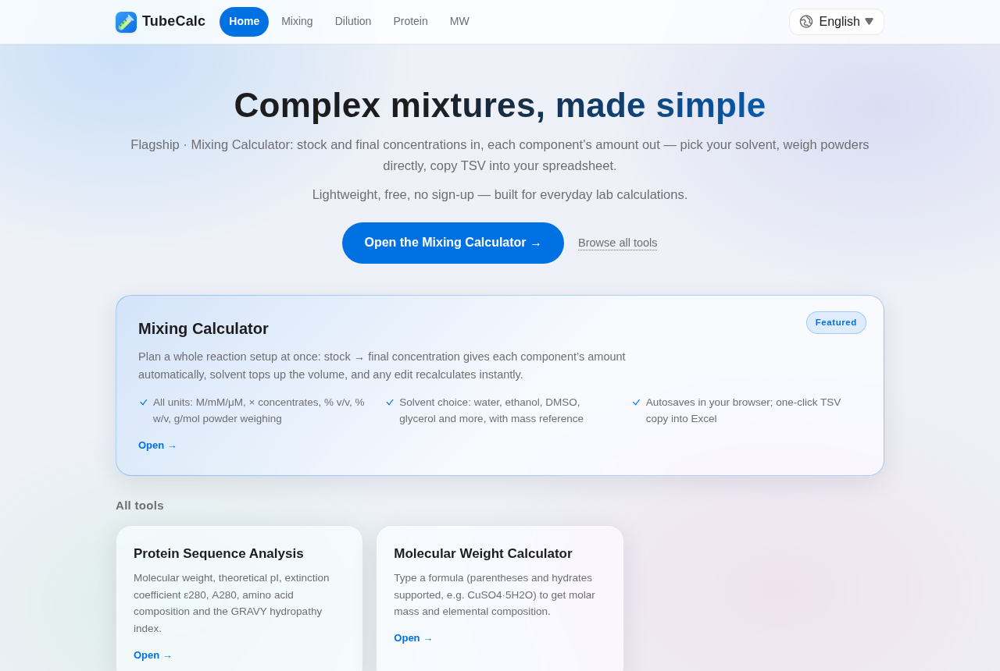
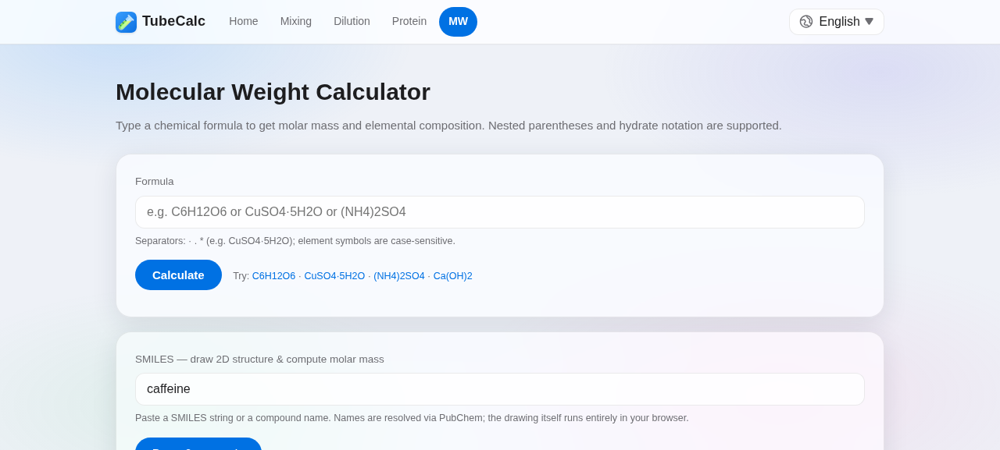

# 🧪 TubeCalc

**Online calculators for the bench: solution preparation, dilution, protein analysis & molecular weight.**

👉 **Try it live: <https://tubecalc.othrik.fyi/>** — free, no install, works offline once loaded (PWA).

<p align="center"></p>

## Tools

| Tool | What it does |
|---|---|
| 🧴 **Solution Preparation** | Stock → final concentration for multi-component mixes: each component’s amount computed (V = C₂V₂/C₁), solvent topped up automatically, % v/v, % w/v, × concentrates, powder weighing mode, TSV copy |
| 💧 **Simple Dilution** | C₁V₁=C₂V₂ with any three fields solved, same-family unit auto-conversion, V₂>V₁ & C₂<C₁ sanity checks, one-click examples |
| 🧬 **Protein Sequence Analysis** | MW, ε280, pI, hydropathy, residue composition from a raw sequence |
| ⚗️ **Molecular Weight & Structure** | One smart box: chemical formulas (nested parentheses, hydrates), SMILES (auto-drawn 2D structure, ChemDraw-style) or compound names via PubChem — mode detected automatically |

<p align="center"></p>

## Highlights

- **6 languages**: English · 中文 · Español · Português · Русский · Français
- **100% client-side** — your data never leaves the browser; PubChem lookups & drawing run on demand
- **KaTeX + mhchem** for publication-quality formulas, all self-hosted
- **Installable PWA** — add to home screen, fully usable offline
- **Apple-style frosted-glass UI**, tuned for phones, tablets and narrow desktop windows

## Tech

Static site built with [Astro](https://astro.build); zero runtime framework — vanilla JS + a few vendored libraries (`smiles-drawer`, `KaTeX`). Deployed behind Cloudflare on nginx.

## Run locally

```bash
bun install && bun run build   # or: npm install && npm run build
npx serve dist                 # open http://localhost:3000
```

## License

MIT — see [LICENSE](LICENSE).
